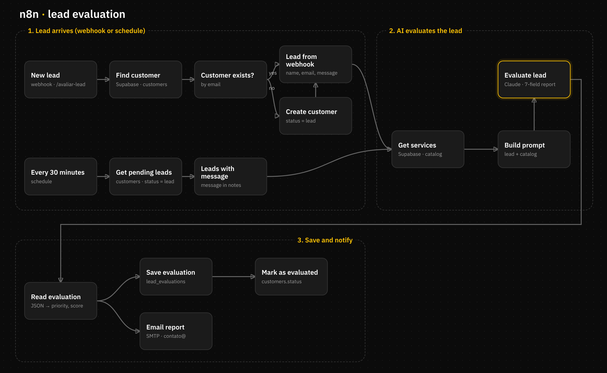
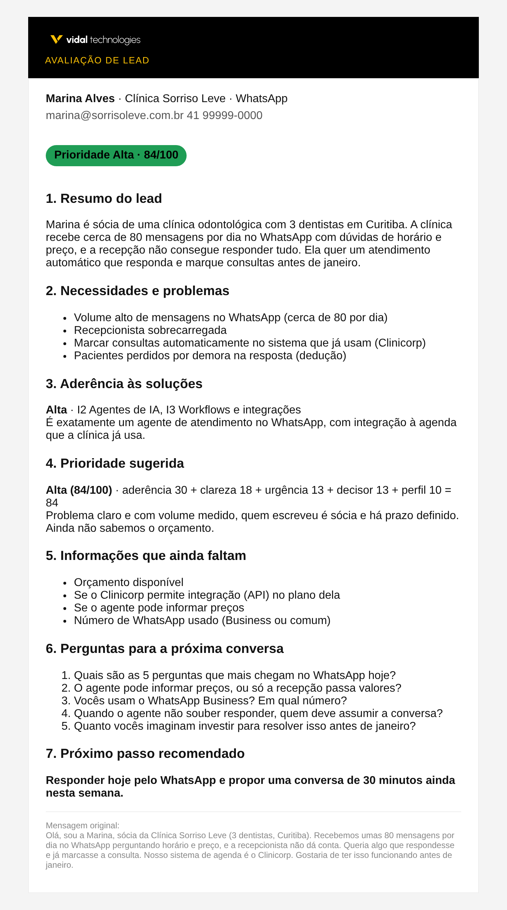
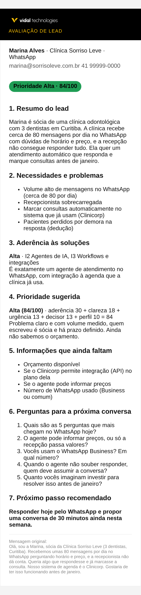

<p align="center">
  
</p>

<h1 align="center">AI lead evaluation agent</h1>

<p align="center">
  A <strong>Vidal Technologies</strong> agent that reads every new contact, compares it with the service catalog and returns a ready-to-use report: summary, needs, fit, priority with a score, missing information, questions for the next conversation and the next step.<br />
  Runs on <strong>n8n</strong> with <strong>Claude</strong> and <strong>Supabase</strong>, or straight from a claude.ai Project.
</p>

<p align="center">
  <a href="README.md">Português</a> · <strong>English</strong> · <a href="README.es.md">Español</a>
</p>

<p align="center">
  
  
  
  
  
</p>



## About the project

Every lead that comes in by email, website form, WhatsApp or referral goes through
the agent. It understands what the person needs, matches it with the Vidal
Technologies services and answers the question that matters: **should we
prioritize this contact, and what do we do now?**

The result is stored in Supabase, linked to the customer record, and reaches the
sales team by email within seconds.

The project is also a portfolio piece: it shows an AI agent applied to the sales
process, the kind of solution Vidal Technologies delivers to its clients.

### What the agent returns

1. **Lead summary:** who they are, what they do and what they are asking for.
2. **Needs and problems:** what was said kept apart from what was inferred.
3. **Fit with our solutions:** High, Medium, Low or Out of scope, with the matching services.
4. **Suggested priority:** High, Medium or Low, with a 0 to 100 score and a reason.
5. **Missing information:** what we still need to know to write a proposal.
6. **Questions for the next conversation:** 3 to 5, ready to use.
7. **Recommended next step:** one concrete action, with channel and timing.

The report itself is written in Portuguese, for the Brazilian sales team.

### How the score works

| Criterion | Points |
| --- | --- |
| Fit with the catalog | 0 to 30 |
| How clear the problem is | 0 to 20 |
| Urgency (a deadline or a reason to act now) | 0 to 15 |
| Decision maker is known | 0 to 15 |
| Profile (small or mid-sized business with signs it can invest) | 0 to 20 |

**High:** 70 or more · **Medium:** 40 to 69 · **Low:** below 40.

## How it works

1. **A lead arrives:** through a **webhook** (`POST /avaliar-lead`) called by the email
   flow, the website or WhatsApp, or **every 30 minutes**, when n8n looks in Supabase
   for customers with `status = lead` and the message in the `notes` field.
2. **Customer in Supabase:** on the webhook path, it looks up the email in `customers`
   and creates the record if it does not exist yet.
3. **Catalog:** reads the active services from the `services` table. Change the
   catalog in Supabase and the agent uses the new version right away.
4. **AI (Claude):** gets the lead and the catalog and returns a JSON with the 7 fields.
   It never makes up names, budgets or deadlines, and never promises prices.
5. **Record:** saves the report in `lead_evaluations` and sets the customer to
   `status = evaluated`.
6. **Notify:** emails the report, with the priority highlighted.

## Screens

| Report on desktop | Report on mobile |
| --- | --- |
|  |  |

## Database

| Table | What it is for |
| --- | --- |
| `customers` | Contacts and leads. Gained `status` (lead, evaluated, in_conversation, proposal, customer, lost) and `source` (email, website, whatsapp, referral, other) |
| `services` | Service catalog (S1 to S4 websites, A1 to A4 web apps, I1 to I4 automation and AI) |
| `lead_evaluations` | Every agent report, with priority, score and the 7 fields. Keeps history: a lead can be evaluated more than once |

## Technologies

| Technology | What it does |
| --- | --- |
| [n8n](https://n8n.io/) | Runs the flow: receives the lead, calls the AI, saves and notifies |
| [Claude](https://www.anthropic.com/claude) (Anthropic) | Analyzes the lead and fills in the report |
| [Supabase](https://supabase.com/) | Customers, catalog and evaluation history |
| JavaScript (n8n Code nodes) | Builds the prompt, validates the JSON and builds the HTML email |
| SMTP (Hostinger) | Sends the report by email |

## How to use

### Option 1: n8n workflow

You will need an n8n account, an Anthropic API key, a Supabase project and an email
account with SMTP.

1. **Database:** in Supabase, open **SQL Editor** and run the files in
   [`supabase/`](supabase/) in order. If the `customers` table already exists (for
   example, from the [email auto-reply](https://github.com/vidaltechnologies/vidaltechnologies-mailbot)
   flow), skip `01-customers.sql`. `04-sample-leads.sql` is optional and adds 3 test leads.
2. **Import the workflow:** in n8n, create a workflow, click the three dots and choose
   **Import from File**. Select [`workflow/lead-evaluation.json`](workflow/lead-evaluation.json).
3. **Credentials:** create and pick the Supabase, Anthropic and SMTP credentials in the nodes.
4. **Customize:** the priority rules live in the **Evaluate lead (Claude)** node. The
   email that gets the report is in the **Email report to Vidal** node.
5. **Test and publish:** run the flow with the test leads and, when everything looks
   right, click **Publish**.

To evaluate a lead from another system, send a `POST` to the webhook:

```json
{
  "name": "Marina Alves",
  "email": "marina@sorrisoleve.com.br",
  "company": "Clínica Sorriso Leve",
  "phone": "41999990000",
  "source": "whatsapp",
  "message": "Recebemos umas 80 mensagens por dia no WhatsApp..."
}
```

### Option 2: claude.ai Project (no server)

1. On [claude.ai](https://claude.ai), create a project called **Avaliador de Leads**.
2. In **Instructions**, paste the content of [`claude-project/instrucoes.md`](claude-project/instrucoes.md).
3. In **Project knowledge**, upload [`claude-project/catalogo.md`](claude-project/catalogo.md).
4. For each lead, open a chat in the project and paste the email, the conversation or
   your notes. See an [example answer](examples/exemplo-avaliacao.md).

The exported n8n file has no passwords or keys. Everyone uses their own credentials.

## Structure

```
workflow/
└── lead-evaluation.json        # Workflow to import into n8n
supabase/
├── 01-customers.sql            # customers table (if it does not exist yet)
├── 02-lead-evaluation.sql      # status/source on customers, services and lead_evaluations
├── 03-services.sql             # Service catalog
└── 04-sample-leads.sql         # Fictional leads for testing
claude-project/
├── instrucoes.md               # Agent instructions for a claude.ai Project
└── catalogo.md                 # Service catalog as text
examples/
└── exemplo-avaliacao.md        # Sample report
docs/                           # Images used in this README
```

---

© Vidal Technologies. All rights reserved.
