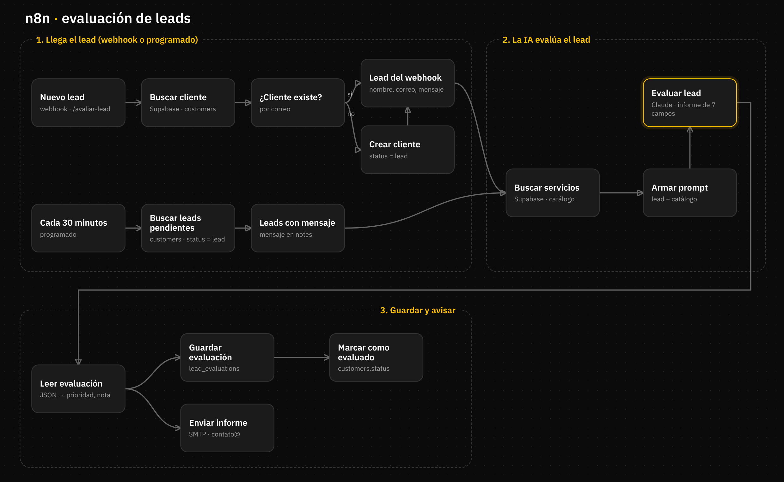
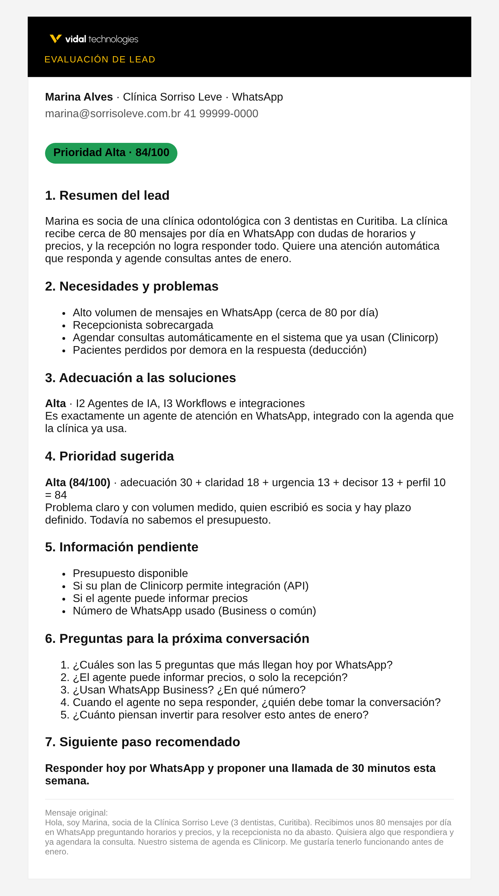
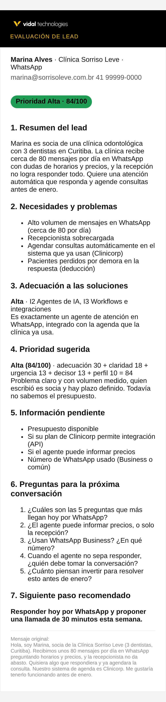

<p align="center">
  
</p>

<h1 align="center">Agente de IA para evaluación de leads</h1>

<p align="center">
  Agente de <strong>Vidal Technologies</strong> que lee cada nuevo contacto, lo compara con el catálogo de servicios y devuelve un informe listo: resumen, necesidades, adecuación, prioridad con nota, información pendiente, preguntas para la próxima conversación y el siguiente paso.<br />
  Funciona en <strong>n8n</strong> con <strong>Claude</strong> y <strong>Supabase</strong>, o directamente en un Proyecto de claude.ai.
</p>

<p align="center">
  <a href="README.md">Português</a> · <a href="README.en.md">English</a> · <strong>Español</strong>
</p>

<p align="center">
  
  
  
  
  
</p>



## Sobre el proyecto

Cada lead que llega por correo, formulario del sitio, WhatsApp o recomendación pasa
por el agente. Entiende lo que la persona necesita, lo cruza con los servicios de
Vidal Technologies y responde la pregunta que importa: **¿vale la pena priorizar
este contacto y qué hacemos ahora?**

El resultado queda guardado en Supabase, vinculado al registro del cliente, y llega
por correo al equipo comercial en pocos segundos.

El proyecto también es una pieza de portafolio: muestra un agente de IA aplicado al
proceso comercial, el tipo de solución que Vidal Technologies entrega a sus clientes.

### Lo que devuelve el agente

1. **Resumen del lead:** quién es, a qué se dedica y qué está pidiendo.
2. **Necesidades y problemas:** separando lo dicho de lo deducido.
3. **Adecuación a las soluciones:** Alta, Media, Baja o Fuera del catálogo, con los servicios indicados.
4. **Prioridad sugerida:** Alta, Media o Baja, con nota de 0 a 100 y justificación.
5. **Información pendiente:** lo que falta saber para armar la propuesta.
6. **Preguntas para la próxima conversación:** de 3 a 5, listas para usar.
7. **Siguiente paso recomendado:** una acción concreta, con canal y plazo.

### Cómo se calcula la nota

| Criterio | Puntos |
| --- | --- |
| Adecuación al catálogo | 0 a 30 |
| Claridad del problema | 0 a 20 |
| Urgencia (plazo o motivo para actuar ahora) | 0 a 15 |
| Se sabe quién decide | 0 a 15 |
| Perfil (pequeña o mediana empresa con señales de inversión) | 0 a 20 |

**Alta:** 70 o más · **Media:** 40 a 69 · **Baja:** menos de 40.

## Cómo funciona

1. **Llega un lead:** por un **webhook** (`POST /avaliar-lead`), llamado por el flujo de
   correos, el sitio o WhatsApp, o **cada 30 minutos**, cuando n8n busca en Supabase los
   clientes con `status = lead` y el mensaje en el campo `notes`.
2. **Cliente en Supabase:** en el webhook, busca el correo en `customers` y crea el
   registro si todavía no existe.
3. **Catálogo:** lee los servicios activos de la tabla `services`. Si cambias el
   catálogo en Supabase, el agente usa la nueva versión enseguida.
4. **IA (Claude):** recibe el lead y el catálogo y devuelve un JSON con los 7 campos.
   Nunca inventa nombres, presupuestos ni plazos, y nunca promete precios.
5. **Registro:** guarda el informe en `lead_evaluations` y cambia el cliente a
   `status = evaluated`.
6. **Aviso:** envía el informe por correo, con la prioridad destacada.

## Pantallas

| Informe en la computadora | Informe en el celular |
| --- | --- |
|  |  |

## Base de datos

| Tabla | Para qué sirve |
| --- | --- |
| `customers` | Contactos y leads. Ganó `status` (lead, evaluated, in_conversation, proposal, customer, lost) y `source` (email, website, whatsapp, referral, other) |
| `services` | Catálogo de servicios (S1 a S4 sitios, A1 a A4 aplicaciones web, I1 a I4 automatización e IA) |
| `lead_evaluations` | Cada informe del agente, con prioridad, nota y los 7 campos. Guarda el historial: un lead puede evaluarse más de una vez |

## Tecnologías

| Tecnología | Para qué sirve |
| --- | --- |
| [n8n](https://n8n.io/) | Orquesta el flujo: recibe el lead, llama a la IA, guarda y avisa |
| [Claude](https://www.anthropic.com/claude) (Anthropic) | Analiza el lead y completa el informe |
| [Supabase](https://supabase.com/) | Clientes, catálogo e historial de evaluaciones |
| JavaScript (nodos Code de n8n) | Arma el prompt, valida el JSON y genera el correo en HTML |
| SMTP (Hostinger) | Envío del informe por correo |

## Cómo usar

### Opción 1: flujo en n8n

Necesitarás una cuenta en n8n, una clave de la API de Anthropic, un proyecto en
Supabase y una cuenta de correo con SMTP.

1. **Base de datos:** en Supabase, abre **SQL Editor** y ejecuta los archivos de
   [`supabase/`](supabase/) en orden. Si la tabla `customers` ya existe (por ejemplo,
   del flujo de [respuesta automática de correos](https://github.com/vidaltechnologies/vidaltechnologies-mailbot)),
   omite `01-customers.sql`. `04-sample-leads.sql` es opcional y agrega 3 leads de prueba.
2. **Importar el flujo:** en n8n, crea un workflow, haz clic en los tres puntos y elige
   **Import from File**. Selecciona [`workflow/lead-evaluation.json`](workflow/lead-evaluation.json).
3. **Credenciales:** crea y elige en los nodos las credenciales de Supabase, Anthropic y SMTP.
4. **Personalizar:** las reglas de prioridad están en el nodo **Evaluate lead (Claude)**.
   El correo que recibe el informe está en el nodo **Email report to Vidal**. El informe
   sale en portugués; para inglés o español, cambia `REPORT_LANGUAGE` a `en` o `es` en
   los nodos **Build prompt** y **Read evaluation**.
5. **Probar y publicar:** ejecuta el flujo con los leads de prueba y, cuando todo esté
   bien, haz clic en **Publish**.

Para evaluar un lead desde otro sistema, envía un `POST` al webhook:

```json
{
  "name": "Marina Alves",
  "email": "marina@sorrisoleve.com.br",
  "company": "Clínica Sorriso Leve",
  "phone": "41999990000",
  "source": "whatsapp",
  "message": "Recebemos umas 80 mensagens por dia no WhatsApp..."
}
```

### Opción 2: Proyecto en claude.ai (sin servidor)

1. En [claude.ai](https://claude.ai), crea un proyecto llamado **Avaliador de Leads**.
2. En **Instructions**, pega el contenido de [`claude-project/instrucoes.md`](claude-project/instrucoes.md).
3. En **Project knowledge**, sube [`claude-project/catalogo.md`](claude-project/catalogo.md).
4. Para cada lead, abre una conversación en el proyecto y pega el correo, la
   conversación o tus notas. Mira un [ejemplo de respuesta](examples/exemplo-avaliacao.md).

El archivo exportado de n8n no tiene contraseñas ni claves. Cada persona usa sus
propias credenciales.

## Estructura

```
workflow/
└── lead-evaluation.json        # Flujo para importar en n8n
supabase/
├── 01-customers.sql            # Tabla customers (si todavía no existe)
├── 02-lead-evaluation.sql      # status/source en customers, services y lead_evaluations
├── 03-services.sql             # Catálogo de servicios
└── 04-sample-leads.sql         # Leads ficticios para prueba
claude-project/
├── instrucoes.md               # Instrucciones del agente para un Proyecto de claude.ai
└── catalogo.md                 # Catálogo de servicios en texto
examples/
└── exemplo-avaliacao.md        # Ejemplo de informe
docs/                           # Imágenes usadas en este README
```

---

© Vidal Technologies. Todos los derechos reservados.
