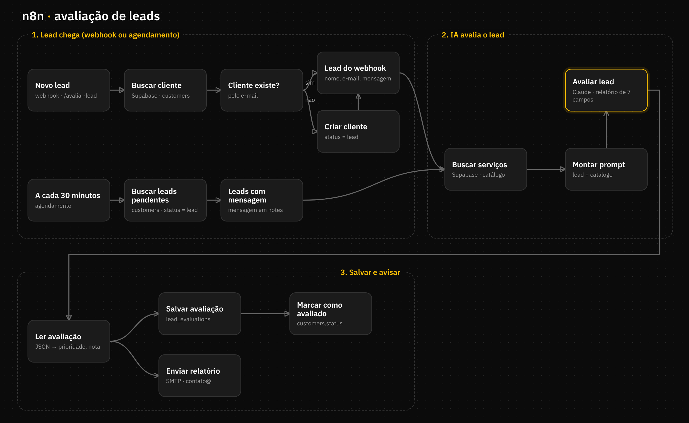
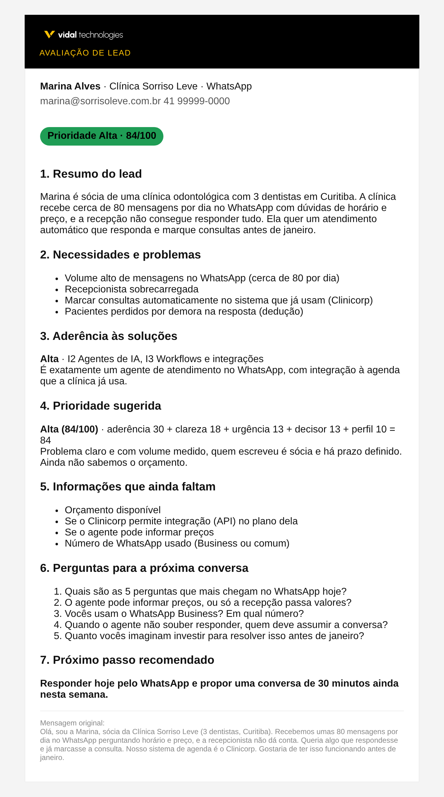
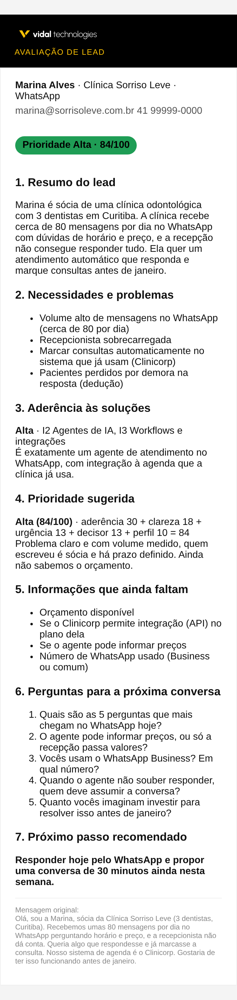

<p align="center">
  
</p>

<h1 align="center">Agente de IA para avaliação de leads</h1>

<p align="center">
  Agente da <strong>Vidal Technologies</strong> que lê cada novo contato, compara com o catálogo de serviços e devolve um relatório pronto: resumo, necessidades, aderência, prioridade com nota, o que falta saber, perguntas para a próxima conversa e o próximo passo.<br />
  Roda no <strong>n8n</strong> com <strong>Claude</strong> e <strong>Supabase</strong>, ou direto em um Projeto do claude.ai.
</p>

<p align="center">
  <strong>Português</strong> · <a href="README.en.md">English</a> · <a href="README.es.md">Español</a>
</p>

<p align="center">
  
  
  
  
  
</p>



## Sobre o projeto

Todo lead que chega por e-mail, formulário do site, WhatsApp ou indicação passa
pelo agente. Ele entende o que a pessoa precisa, cruza com os serviços da Vidal
Technologies e responde à pergunta que importa: **vale a pena priorizar este
contato, e o que fazer agora?**

O resultado fica guardado no Supabase, ligado ao cadastro do cliente, e chega por
e-mail para a equipe comercial em poucos segundos.

O projeto também funciona como peça de portfólio: mostra, na prática, um agente de
IA aplicado ao processo comercial, o tipo de solução que a Vidal Technologies
entrega para os clientes.

### O que o agente devolve

1. **Resumo do lead:** quem é, o que faz e o que está pedindo.
2. **Necessidades e problemas:** separando o que foi dito do que foi deduzido.
3. **Aderência às soluções:** Alta, Média, Baixa ou Fora do catálogo, com os serviços indicados.
4. **Prioridade sugerida:** Alta, Média ou Baixa, com nota de 0 a 100 e justificativa.
5. **Informações que ainda faltam:** o que precisamos saber para montar a proposta.
6. **Perguntas para a próxima conversa:** de 3 a 5, prontas para usar.
7. **Próximo passo recomendado:** uma ação concreta, com canal e prazo.

### Como a nota é calculada

| Critério | Pontos |
| --- | --- |
| Aderência ao catálogo | 0 a 30 |
| Clareza do problema | 0 a 20 |
| Urgência (prazo ou motivo para agir agora) | 0 a 15 |
| Quem decide está claro | 0 a 15 |
| Perfil (pequena ou média empresa com sinais de investimento) | 0 a 20 |

**Alta:** 70 ou mais · **Média:** 40 a 69 · **Baixa:** abaixo de 40.

## Como funciona

1. **Lead chega:** por um **webhook** (`POST /avaliar-lead`), chamado pelo fluxo de
   e-mails, pelo site ou pelo WhatsApp, ou a **cada 30 minutos**, quando o n8n busca no
   Supabase os clientes com `status = lead` e a mensagem no campo `notes`.
2. **Cliente no Supabase:** no webhook, procura o e-mail na tabela `customers` e cria
   o cadastro se ainda não existir.
3. **Catálogo:** lê os serviços ativos da tabela `services`. Mudou o catálogo no
   Supabase, o agente já usa a versão nova.
4. **IA (Claude):** recebe o lead e o catálogo e devolve um JSON com os 7 campos. A
   IA nunca inventa nome, orçamento ou prazo, e nunca promete preço.
5. **Registro:** grava o relatório em `lead_evaluations` e muda o cliente para
   `status = evaluated`.
6. **Aviso:** envia o relatório por e-mail, com a prioridade em destaque.

## Telas

| Relatório no computador | Relatório no celular |
| --- | --- |
|  |  |

## Banco de dados

| Tabela | Para que serve |
| --- | --- |
| `customers` | Contatos e leads. Ganhou `status` (lead, evaluated, in_conversation, proposal, customer, lost) e `source` (email, website, whatsapp, referral, other) |
| `services` | Catálogo de serviços (S1 a S4 sites, A1 a A4 aplicações web, I1 a I4 automação e IA) |
| `lead_evaluations` | Cada relatório do agente, com prioridade, nota e os 7 campos. Guarda o histórico: um lead pode ser avaliado mais de uma vez |

## Tecnologias

| Tecnologia | Para que serve |
| --- | --- |
| [n8n](https://n8n.io/) | Orquestra o fluxo: recebe o lead, chama a IA, grava e avisa |
| [Claude](https://www.anthropic.com/claude) (Anthropic) | Analisa o lead e preenche o relatório |
| [Supabase](https://supabase.com/) | Clientes, catálogo e histórico de avaliações |
| JavaScript (nós Code do n8n) | Monta o prompt, valida o JSON e gera o e-mail em HTML |
| SMTP (Hostinger) | Envio do relatório por e-mail |

## Como usar

### Opção 1: fluxo no n8n

Você vai precisar de uma conta no n8n, uma chave da API da Anthropic, um projeto no
Supabase e uma conta de e-mail com SMTP.

1. **Banco de dados:** no Supabase, abra **SQL Editor** e rode os arquivos da pasta
   [`supabase/`](supabase/) na ordem. Se a tabela `customers` já existir (por exemplo,
   do fluxo de [resposta automática de e-mails](https://github.com/vidaltechnologies/vidaltechnologies-mailbot)),
   pule o `01-customers.sql`. O `04-sample-leads.sql` é opcional e traz 3 leads de teste.
2. **Importar o fluxo:** no n8n, crie um workflow, clique nos três pontos e escolha
   **Import from File**. Selecione [`workflow/lead-evaluation.json`](workflow/lead-evaluation.json).
3. **Credenciais:** crie e escolha nos nós as credenciais de Supabase, Anthropic e SMTP.
4. **Personalizar:** as regras de prioridade ficam no nó **Evaluate lead (Claude)**. O
   e-mail que recebe o relatório fica no nó **Email report to Vidal**. O relatório sai
   em português; para inglês ou espanhol, troque `REPORT_LANGUAGE` para `en` ou `es`
   nos nós **Build prompt** e **Read evaluation**.
5. **Testar e publicar:** rode o fluxo com os leads de teste e, quando estiver tudo
   certo, clique em **Publish**.

Para avaliar um lead a partir de outro sistema, envie um `POST` para o webhook:

```json
{
  "name": "Marina Alves",
  "email": "marina@sorrisoleve.com.br",
  "company": "Clínica Sorriso Leve",
  "phone": "41999990000",
  "source": "whatsapp",
  "message": "Recebemos umas 80 mensagens por dia no WhatsApp..."
}
```

### Opção 2: Projeto no claude.ai (sem servidor)

1. No [claude.ai](https://claude.ai), crie um projeto chamado **Avaliador de Leads**.
2. Em **Instructions**, cole o conteúdo de [`claude-project/instrucoes.md`](claude-project/instrucoes.md).
3. Em **Project knowledge**, envie [`claude-project/catalogo.md`](claude-project/catalogo.md).
4. A cada lead, abra uma conversa no projeto e cole o e-mail, a conversa ou suas
   anotações. Veja um [exemplo de resposta](examples/exemplo-avaliacao.md).

O arquivo exportado do n8n não tem nenhuma senha ou chave. Cada pessoa usa as
próprias credenciais.

## Estrutura

```
workflow/
└── lead-evaluation.json        # Fluxo para importar no n8n
supabase/
├── 01-customers.sql            # Tabela customers (se ainda não existir)
├── 02-lead-evaluation.sql      # status/source em customers, services e lead_evaluations
├── 03-services.sql             # Catálogo de serviços
└── 04-sample-leads.sql         # Leads fictícios para teste
claude-project/
├── instrucoes.md               # Instruções do agente para um Projeto do claude.ai
└── catalogo.md                 # Catálogo de serviços em texto
examples/
└── exemplo-avaliacao.md        # Exemplo de relatório
docs/                           # Imagens usadas neste README
```

---

© Vidal Technologies. Todos os direitos reservados.
